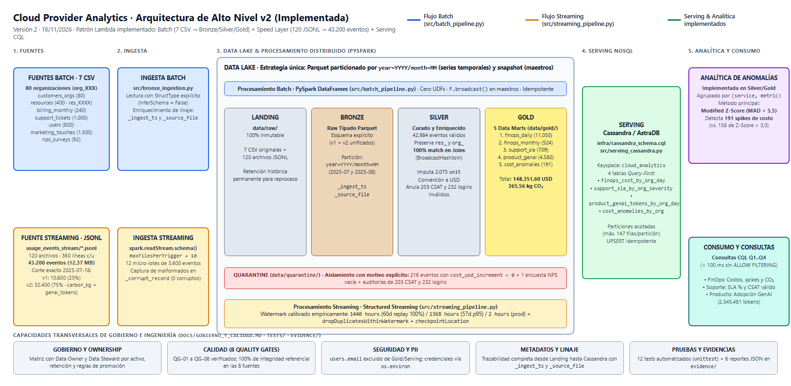
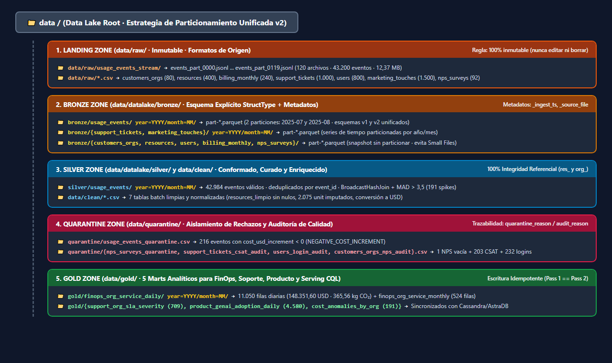
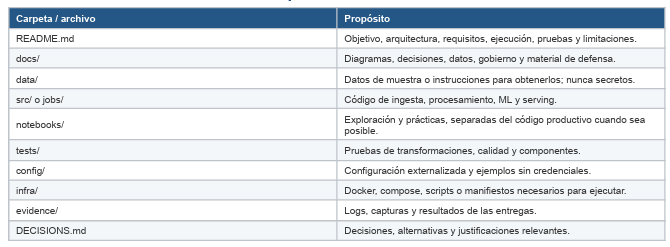

**INSTITUTO SUPERIOR TECNOLÓGICO EMPRESARIAL ARGENTINO (ISTEA)**
MINERÍA DE DATOS II - 2C 2026
Proyecto Integrador Obligatorio: Cloud Provider Analytics

# Documento de diseño arquitectónico y fundación de datos

## Interpretación del problema, usuarios y objetivos medibles

**Contexto del Negocio:** La empresa opera como un proveedor global de servicios de infraestructura en la nube (Cloud Provider). El problema con el que nos encontramos es que la información operativa, financiera y de soporte está fragmentada en silos aislados (bases CRM de clientes, sistemas de facturación mensual y telemetría de eventos de uso de recursos). Esta desconexión impide consolidar una visión unificada del cliente, dificulta el análisis de rentabilidad por servicio y atrasa la detección de picos de gasto o posibles bajas de cuenta.

El proyecto propone construir un flujo de datos de punta a punta: ingestar las fuentes (batch para CRM, facturación, tickets y referencias; streaming para los eventos de uso), limpiarlas y unificarlas en capas (Bronze, Silver y Gold), y publicar los resultados en Cassandra/AstraDB para que se puedan consultar rápido por clave de partición.

### Usuarios y preguntas principales

| **Dominio** | **Usuario** | **Pregunta Principal de Negocio** |
| --- | --- | --- |
| FinOps | Director de Finanzas & Controller | ¿Cuál es el costo diario y mensual por organización y servicio en USD, y qué desvíos o anomalías existen? |
| Soporte | Head of Customer Support | ¿Cuál es la tasa de incumplimiento de SLA y la satisfacción (CSAT) promedio por severidad y categoría? |
| Producto | VP de Infraestructura & Cloud | ¿Cómo evoluciona el consumo de capacidades críticas (Compute, DB, GenAI tokens, huella de carbono)? |

### Objetivos medibles del proyecto

- **Calidad de datos en ingesta:** el 100 % de los registros que incumplen las reglas de calidad se desvía a Quarantine con su motivo de rechazo, sin detener el pipeline, y el porcentaje de rechazos se reporta en cada corrida.
- **Latencia de Serving:** las consultas sobre Cassandra/AstraDB responden en menos de 100 ms cuando se filtran por clave de partición, sin usar `ALLOW FILTERING`.
- **Evolución de esquemas:** el 100 % de los eventos v1 y v2 se leen sin errores, y `carbon_kg` y `genai_tokens` existen en el esquema de Silver (nulos para los eventos v1).

## Justificación de la necesidad de Big Data mediante las 5V (Lo medido vs. lo proyectado)

Para no atribuirle a la muestra del trabajo práctico un volumen que por sí solo desborde una máquina local, separamos en cada dimensión lo que **medimos sobre los archivos del repositorio** de lo que **proyectamos para la operación real del proveedor cloud**:

| **Dimensión (V)** | **Lo medido en la muestra del TP** | **Lo proyectado a escala productiva** | **Impacto técnico y decisión en el proyecto** |
| --- | --- | --- | --- |
| **Volumen** | 47.212 registros en total (12,73 MB): 4.012 filas repartidas en 7 archivos CSV (0,36 MB) y 43.200 eventos en 120 archivos JSONL de 360 líneas (12,37 MB, 60 días a 720 eventos/día). | Más de 10.000 organizaciones y cientos de miles de recursos emitiendo telemetría cada minuto (~540 millones de eventos/mes, ~160 GB/mes crudos y > 2 TB/año). | La muestra cabe en memoria local, pero implementamos Parquet particionado por `year=YYYY/month=MM` y procesamiento en PySpark para validar el diseño sin generar miles de archivos chicos (*small files*). |
| **Velocidad** | Los 120 archivos JSONL llegan fragmentados en micro-lotes (`maxFilesPerTrigger = 10`, 12 tandas de 3.600 eventos), pero traen un desorden de fechas de hasta 60 días dentro de cada archivo. | Flujo continuo de eventos las 24 horas que requiere detectar picos de gasto (`MAD > 3,5`) en minutos sin esperar al cierre de facturación de fin de mes. | Usamos PySpark Structured Streaming con `withWatermark` calibrado sobre los datos medidos (`1440 hours` para correr la muestra desordenada sin pérdidas, `1368 hours` para cubrir el percentil 95, y `2 hours` en operación real ordenada). |
| **Variedad** | Conviven 7 tablas CSV relacionales, una columna con JSON anidado de etiquetas variables (`tags_json` en `resources.csv`) y 120 archivos JSONL donde el esquema cambia de `v1` (10.800 eventos hasta el 17/07) a `v2` (32.400 eventos desde el 18/07 con `carbon_kg` y `genai_tokens`). | Nuevas versiones de telemetría (v3+) al sumar servicios cloud, logs de auditoría y métricas de nuevos modelos de GenAI. | Data Lake multicapa: Landing conserva los formatos originales, y Bronze/Silver unifican todo con `StructType` explícito (sin `inferSchema`), desanidando `tags_json` en columnas fijas. |
| **Veracidad** | Medimos anomalías concretas en casi todas las fuentes: 216 eventos (0,5 %) con costo negativo (hasta −154,46 USD), 2.075 eventos (4,8 %) sin `unit`, 877 (2,03 %) sin `value`, 137 facturas sin `credits`, 3 monedas (`USD`, `ARS`, `EUR`), 13 subtotales negativos, 40 CSAT fuera de 1..5, 163 tickets abiertos con CSAT, 232 usuarios con `last_login < created_at`, 1 `nps_score = 101` y 1 encuesta NPS vacía. | Retrasos de red, reintentos de envío que duplican eventos, relojes desincronizados entre regiones y cambios de cotización de monedas. | Reglas de calidad en `src/quality_rules.py`: los registros inválidos se desvían a `data/quarantine/` con su motivo, las unidades faltantes se recuperan desde `metric` y la integridad referencial (`res_` y `org_`) se valida al 100 %. |
| **Valor** | Con los 42.984 eventos válidos se consolidan 148.351,60 USD de consumo, 365,56 kg de CO2, 2.545.481 tokens de GenAI (en 3.132 eventos) y 191 spikes de costo detectados por MAD, cruzados con SLA de soporte y facturación de las 80 organizaciones. | Tableros operativos de FinOps, alertas tempranas de sobrecosto por centro de costo/equipo y seguimiento de SLA y adopción de GenAI para reducir bajas (churn). | Construcción de 5 marts en `data/gold/` y carga idempotente en 4 tablas de Cassandra/AstraDB modeladas según las consultas Q1 a Q4. |

## Inventario y perfil de las fuentes de datos

El sistema consolida las 8 fuentes de datos de las mismas 80 organizaciones (`org_...`). A continuación se resume lo medido en cada una:

| **Fuente** | **Grano y volumen medido** | **Frecuencia** | **Campos clave** | **Problemas encontrados y cómo se resuelven** |
| --- | --- | --- | --- | --- |
| `customers_orgs.csv` | 1 fila por organización (80 filas) | Mensual / Batch | `org_id` (PK), `industry`, `hq_region`, `plan_tier`, `lifecycle_stage`, `nps_score` | Un `nps_score` fuera de escala (`101`) que se pasa a nulo, y 11 nulos originales que se conservan sin inventar promedios. |
| `users.csv` | 1 fila por usuario (800 filas) | Diario / Batch | `user_id` (PK), `org_id` (FK), `email`, `role`, `active`, `created_at`, `last_login` | 232 filas tienen `last_login < created_at`: se anula `last_login` y se anota en `users_login_audit.csv`. El `email` (PII) no pasa a Gold ni a Cassandra. |
| `resources.csv` | 1 fila por recurso (400 filas) | Batch | `resource_id` (PK), `org_id` (FK), `service`, `region`, `state`, `tags_json` | 83 filas sin `tags_json`. Se desanida en `env`, `pii`, `costcenter`, `team` y `backup` completando faltantes con categorías explícitas, y se conservan los prefijos `res_` y `org_` para que crucen al 100 % con los eventos. |
| `support_tickets.csv` | 1 fila por ticket (1.000 filas) | Diario / Batch | `ticket_id` (PK), `org_id` (FK), `category`, `severity`, `created_at`, `resolved_at`, `csat`, `sla_breached` | 240 tickets siguen abiertos. Hay 40 CSAT fuera de 1..5 (`0`, `6`, `7`) y 163 tickets abiertos con CSAT en rango: esos 203 CSAT pasan a nulo (`support_tickets_csat_audit.csv`), quedando 543 notas válidas. |
| `marketing_touches.csv` | 1 fila por contacto (1.500 filas) | Diario / Batch | `touch_id` (PK), `org_id` (FK), `campaign`, `channel`, `timestamp`, `clicked`, `converted` | Sin nulos ni duplicados (453 clicks y 144 conversiones entre mayo y agosto de 2025). Se deriva la columna `mes` (`YYYY-MM`). |
| `nps_surveys.csv` | 1 fila por encuesta (92 filas crudas → 91 limpias) | Mensual / Batch | `(org_id, survey_date)` (PK), `nps_score`, `comment` | Respuestas de 60 organizaciones. Una fila venía sin puntaje ni comentario (`org_064`, `2025-07-09`) y se pasa a `nps_surveys_quarantine.csv`. |
| `billing_monthly.csv` | 1 fila por factura/mes (240 filas, 3 meses × 80 orgs) | Mensual / Batch | `invoice_id` (PK), `org_id` (FK), `month`, `subtotal`, `credits`, `taxes`, `currency`, `exchange_rate_to_usd` | 137 `credits` vacíos se completan con `0.0`. Hay facturas en `USD` (160), `ARS` (51) y `EUR` (29): todas se convierten a `_usd`. Las 13 filas con `subtotal < 0` se conservan como notas de crédito. |
| `usage_events_stream` | 1 fila por evento (120 archivos × 360 = 43.200 eventos) | Micro-lotes / Stream | `event_id` (PK), `org_id` (FK), `resource_id` (FK), `timestamp`, `service`, `metric`, `value`, `unit`, `cost_usd_increment`, `schema_version` | Cambio de esquema v1 (10.800) a v2 (32.400 con `carbon_kg` y `genai_tokens`) el `2025-07-18`; 216 costos negativos a Quarantine; 2.075 `unit` vacíos completados desde `metric`; desorden temporal de 60 días entre archivos. |

## Diagrama de arquitectura de alto nivel

## Justificación del patrón

Se selecciona la **Arquitectura Lambda** por la combinación de fuentes y tiempos de respuesta del caso:

- **Capa de Velocidad (Speed Layer):** procesa los micro-lotes de `usage_events_stream` con PySpark Structured Streaming (`src/streaming_pipeline.py`), aplicando validación de costos negativos, watermarking calibrado (`withWatermark`), deduplicación por `event_id` (`dropDuplicatesWithinWatermark`) y checkpointing. Permite actualizar el consumo diario por organización y servicio sin esperar al cierre mensual.
- **Capa de Lote (Batch Layer):** corre sobre el Data Lake (`src/batch_pipeline.py` y `src/pyspark_etl.py`) procesando las 7 tablas CSV y el conjunto completo de eventos. Garantiza el cruce con dimensiones limpias (`broadcast join` con organizaciones y recursos), el cálculo de anomalías sobre toda la distribución de cada `(service, metric)` (`MAD > 3,5`) y la reconciliación contra `billing_monthly.csv`.
- **Capa de Servicio (Serving Layer):** publica los marts de Gold en Apache Cassandra / AstraDB (`infra/cassandra_schema.cql` y `src/serving_cassandra.py`). Las cuatro tablas están armadas a partir de las consultas Q1 a Q4 para responder lecturas puntuales por organización y período sin escanear archivos Parquet.

Descartamos un enfoque solo Batch porque no cubre el procesamiento incremental por micro-lotes con control de estado y watermark sobre `usage_events_stream`, y descartamos Kappa porque siete de las ocho fuentes son tablas maestras, encuestas y facturación mensual en CSV que no tiene sentido forzar como flujos de eventos.

La matriz que relaciona cada objetivo con el módulo del repositorio que lo resuelve está en [MATRIZ_REQUISITO_COMPONENTE.md](MATRIZ_REQUISITO_COMPONENTE.md).

## Diseño detallado del Data Lake y estrategia única de particionamiento

Para corregir la inconsistencia observada en la primera entrega (donde en distintas partes del documento aparecían particiones por `year/month`, `service`, `org_id` o `metric_type`), fijamos **una única estrategia de particionamiento por dataset en todas las capas** (`config/pipeline_config.json`):

| **Zona** | **Propósito y Formato** | **Estrategia Única de Particionamiento** | **Reglas de Promoción y Metadatos** |
| --- | --- | --- | --- |
| **Landing** (`data/raw/`) | Archivos crudos tal cual llegan del origen (7 CSV y 120 JSONL). | Sin partición adicional (archivos originales en `data/raw/` y `data/raw/usage_events_stream/`). | 100 % inmutable. Ningún proceso edita ni borra archivos de esta carpeta. |
| **Bronze** (`data/datalake/bronze/`) | Datos crudos tipados en Parquet con esquema explícito (`StructType`). | **Series de tiempo** (`usage_events`, `support_tickets`, `marketing_touches`): `year=YYYY/month=MM`. **Tablas chicas** (`customers_orgs`, `resources`, `users`, `billing_monthly`, `nps_surveys`): sin partición de carpetas. | Lectura sin `inferSchema`. Se agregan `_ingest_ts` y `_source_file`. |
| **Silver** (`data/datalake/silver/` y `data/clean/`) | Datos limpios, deduplicados, normalizados y enriquecidos. | **Series de tiempo** (`usage_events`, `support_tickets`, `marketing_touches`): `year=YYYY/month=MM` (ordenados internamente por `service, org_id`). **Dimensiones y tablas chicas**: sin partición de carpetas. | Solo pasan registros válidos. Conserva prefijos `res_` y `org_` (100 % de integridad en joins), completa `unit` desde `metric`, convierte divisas a USD y calcula `is_mad_spike`. |
| **Gold** (`data/gold/`) | Marts de negocio agregados para FinOps, Soporte y Producto, listos para Serving. | **Marts diarios** (`finops_org_service_daily`, `product_genai_adoption_daily`): `year=YYYY/month=MM`. **Marts resumidos** (`finops_org_service_monthly`, `support_org_sla_severity`, `cost_anomalies_by_org`): sin partición de carpetas. | Escritura idempotente (dos corridas seguidas producen las mismas filas y el mismo total en USD). |
| **Quarantine** (`data/quarantine/`) | Aislamiento de registros rechazados y auditorías de limpieza. | Un archivo/tabla por fuente afectada (`usage_events_quarantine`, `nps_surveys_quarantine`, auditorías de CSAT, login y NPS). | Guarda el registro original junto con `quarantine_reason` o `audit_reason` para poder auditar qué falló sin perder trazabilidad. |

### Justificación del particionamiento elegido (prevención de *small files*)

Al particionar buscamos que las consultas por período lean solo los meses necesarios sin escanear todo el disco, pero sin dividir de más y generar cientos de archivos diminutos:

- **Por qué `year=YYYY/month=MM` en eventos y series de tiempo:** los 43.200 eventos pesan **12,37 MB** y caen en dos meses (`2025-07` con 20.880 eventos y `2025-08` con 22.320 eventos). Con `year=YYYY/month=MM` quedan 2 particiones mensuales de buen tamaño (~6 MB de datos cada una). Si además particionáramos por `service` (6 servicios) y `org_id` (80 organizaciones), esos 12,37 MB se romperían en hasta `2 × 6 × 80 = 960` carpetas con archivos de ~13 KB, degradando la lectura en Spark por el costo de abrir tantos directorios. Para acelerar los filtros por servicio y cliente sin crear más carpetas, ordenamos los datos dentro de cada partición mensual con `sortWithinPartitions("service", "org_id")`, aprovechando las estadísticas min/max de los bloques internos de Parquet.
- **Por qué sin partición en tablas maestras y marts resumidos:** tablas de 80 a 800 filas (`customers_orgs`, `resources`, `users`, `billing_monthly`, `nps_surveys`, `finops_org_service_monthly` de 524 filas y `support_org_sla_severity` de 709 filas) pesan pocos kilobytes; leerlas en un único archivo es más rápido y permite enviarlas por `broadcast` a todos los ejecutores de Spark.

### Metadatos técnicos, retención y promoción

- **Metadatos agregados:** `_ingest_ts` (timestamp UTC de carga), `_source_file` (archivo de origen en `data/raw/`), `schema_version` (`1` o `2` en eventos) y `quarantine_reason` / `audit_reason` en `data/quarantine/`.
- **Retención por zona:**
  - **Landing (`data/raw/`):** permanente (inmutable para reprocesar desde cero).
  - **Bronze:** 1 a 2 años.
  - **Silver:** histórica activa (2 años).
  - **Gold:** 12 a 24 meses.
  - **Quarantine:** 30 a 90 días para revisión y corrección en origen.

## Flujo de datos batch y streaming desde las fuentes hasta las salidas

### Pipeline Batch (`src/batch_pipeline.py` y `src/pyspark_etl.py`)

1. **Ingesta (Landing → Bronze):** lectura de los 7 CSV y los 120 JSONL con esquemas explícitos (`src/schemas.py`), sin `inferSchema`, agregando `_ingest_ts` y `_source_file`.
2. **Calidad y transformación (Bronze → Silver + Quarantine):**
   - Normalización de textos (`trim`, `lower`), fechas en formato ISO y conservación de los prefijos `org_`, `res_`, `user_`, `tkt_`, `inv_`, `mkt_` y `evt_`.
   - En `billing_monthly`, los 137 `credits` vacíos pasan a `0.0` y se calculan `subtotal_usd`, `credits_usd`, `taxes_usd` y `net_billed_usd` multiplicando por `exchange_rate_to_usd`. Las 13 filas con subtotal negativo se marcan con `is_credit_note = True`.
   - En `support_tickets`, los 40 CSAT fuera de 1..5 y los 163 CSAT de tickets abiertos pasan a `NULL` y se listan en `data/quarantine/support_tickets_csat_audit.csv`.
   - En `usage_events`, se desvían a `data/quarantine/usage_events_quarantine.csv` los **216 eventos con `cost_usd_increment < 0`**, se deduplica por `event_id` (42.984 válidos), se completan los 2.075 `unit` vacíos según `metric`, se cruza con `customers_orgs` (80 filas) y `resources` (400 filas) mediante **`F.broadcast()`** (100 % de match) y se marcan los **191 spikes de costo** con **Modified Z-Score (`MAD > 3,5`) agrupado por `(service, metric)`** (usando `Window.partitionBy("service", "metric")` y `F.percentile_approx`).
3. **Agregación (Silver → Gold):** construcción de los cinco marts en `data/gold/`:
   - `finops_org_service_daily.csv` (11.050 filas)
   - `finops_org_service_monthly.csv` (524 filas, cruzado con la facturación mensual de cada cliente)
   - `support_org_sla_severity.csv` (709 filas)
   - `product_genai_adoption_daily.csv` (4.580 filas)
   - `cost_anomalies_by_org.csv` (191 filas con los spikes de costo detectados por MAD)

### Pipeline Streaming y calibración empírica del watermark (`src/streaming_pipeline.py`)

El perfilado de los 120 archivos JSONL ([docs/perfilado_usage_events.md](perfilado_usage_events.md)) mostró por qué había que cambiar el watermark de 1 hora que figuraba en la primera entrega:

1. **Qué pasa en los archivos:**
   - Aunque los 43.200 eventos cubren del `2025-07-03` al `2025-08-31` (60 días), dentro de cada archivo vienen mezcladas fechas de casi los dos meses completos (mediana de rango intra-archivo = 59,76 días).
   - Ya en el primer archivo (`events_part_0000.jsonl`) entra un evento con timestamp `2025-08-31T16:32:00Z`.
   - Cuando Spark cierra el primer micro-lote y calcula el watermark como `max_event_time - tolerancia`, con una tolerancia de `1 hour` el umbral salta a `2025-08-31T15:32:00Z` desde el arranque. En consecuencia, en los lotes siguientes descarta **42.801 de los 43.200 eventos (99,08 %)** si lee de a 1 archivo por trigger, o **39.366 de los 42.984 eventos válidos (91,58 %, perdiendo 134.853,01 USD)** si lee de a 10 archivos por trigger (`maxFilesPerTrigger = 10`).
   - Medimos los percentiles de retraso en los lotes 1 al 119: mediana (`p50`) = 720,08 horas (30 días), `p90` = 1.296,13 horas (54 días), `p95` = 1.368,00 horas (57 días) y máximo (`p100`) = 1.439,90 horas (60 días).

2. **Cómo quedó configurado en el pipeline (`config/pipeline_config.json` y `src/streaming_pipeline.py`):**
   - Lectura por micro-lotes con `spark.readStream.schema(events_schema)` y `maxFilesPerTrigger = 10` (12 triggers de 10 archivos = 3.600 eventos por lote).
   - Separación inmediata de los 216 eventos con costo negativo a `Quarantine` antes de agregar.
   - El umbral de `withWatermark("event_ts", delay)` y `dropDuplicatesWithinWatermark(["event_id"])` se toma de `config/pipeline_config.json` según el perfil:
     - **`replay_full` (`1440 hours` = 60 días):** retiene el **100 % de los eventos válidos (42.984)** y converge exactamente al mismo total que el pipeline Batch (**148.351,60 USD** y **365,56 kg de CO2**).
     - **`replay_p95` (`1368 hours` = 57 días):** cubre hasta el percentil 95 de retraso medido, reteniendo **41.009 eventos válidos (95,41 %)**.
     - **`production_realtime` (`2 hours`):** perfil para cuando el stream recibe eventos nuevos en tiempo real ordenados, dejando cualquier rezagado de más de 2 horas para el reproceso diario de la capa Batch.
   - Cada flujo escribe su estado en `data/datalake/checkpoints/`. En `evidence/streaming_pipeline_resumen.json` verificamos que al correr una segunda vez sobre el mismo checkpoint, el proceso salta los 12 micro-lotes ya confirmados sin duplicar datos.

## Capa de Serving en Apache Cassandra / AstraDB (`infra/cassandra_schema.cql` y `src/serving_cassandra.py`)

Modelamos cuatro tablas en el keyspace `cloud_analytics` partiendo de las consultas operativas (una tabla desnormalizada por consulta, sin joins en lectura ni `ALLOW FILTERING`):

| Tabla CQL | Consulta de negocio que resuelve | `PRIMARY KEY ((Partition Key), Clustering Columns)` | Orden de clustering y tamaño medido de partición |
| --- | --- | --- | --- |
| `finops_cost_by_org_day` | **Q1 (FinOps):** Costo diario en USD, cantidad de eventos, carbono (`total_carbon_kg`) y spikes por servicio para una organización en un mes dado. | `PRIMARY KEY ((org_id, year_month), usage_date, service)` | `CLUSTERING ORDER BY (usage_date DESC, service ASC)`. Hay 160 particiones (80 orgs × 2 meses) y 11.050 filas: cada partición tiene entre 14 y **147 filas** (promedio 69,06). Incluir `year_month` en la clave de partición evita que la partición crezca sin límite con los años. |
| `support_sla_by_org_severity` | **Q2 (Soporte):** Total de tickets, abiertos, tasa de SLA vencido (`%`), horas promedio de resolución y CSAT válido promedio por severidad y categoría para una organización. | `PRIMARY KEY ((org_id), severity, category)` | `CLUSTERING ORDER BY (severity ASC, category ASC)`. Hay 80 particiones y 709 filas (máximo **14 filas** por partición, promedio 8,86). |
| `product_genai_tokens_by_org_day` | **Q3 (Producto / GenAI):** Evolución diaria de eventos GenAI, tokens consumidos (`genai_tokens_total`), costo GenAI, porcentaje sobre el gasto total del cliente y usuarios activos en un mes. | `PRIMARY KEY ((org_id, year_month), usage_date)` | `CLUSTERING ORDER BY (usage_date DESC)`. Hay 160 particiones y 4.580 filas (máximo **31 filas** por partición, una por día del mes). |
| `cost_anomalies_by_org` | **Q4 (Alertas FinOps):** Últimos eventos marcados como spikes de costo (`MAD > 3,5`) para una organización, con su recurso, métrica, centro de costo y equipo. | `PRIMARY KEY ((org_id), timestamp, event_id)` | `CLUSTERING ORDER BY (timestamp DESC, event_id ASC)`. Hay 69 particiones con spikes y 191 filas en total (máximo **9 filas** por partición). |

La escritura en Cassandra es idempotente porque `INSERT` sobre la misma clave primaria natural actúa como *upsert*: probamos insertar dos veces seguidas las cuatro tablas desde `src/serving_cassandra.py` y los conteos por partición se mantienen idénticos (`evidence/serving_cassandra_resumen.json`).

## Flujo batch de referencia en lógica MapReduce (grano consistente)

En la primera entrega el ejemplo de MapReduce mezclaba `billing_monthly` y los eventos para emitir la clave `(org_id, year_month, service)`, pero `billing_monthly` tiene grano mensual por cliente `(org_id, month)` y no trae la columna `service`.

Para corregirlo, formulamos y corrimos el MapReduce de punta a punta sobre **una única fuente con grano homogéneo (`usage_events_stream`)**, respondiendo: *¿cuál es el costo mensual acumulado en USD, la huella de carbono (kg CO2) y la cantidad de eventos válidos por organización, mes y servicio?*

Los resultados medidos sobre los 120 archivos están en `evidence/mapreduce_finops_resumen.json`:

| **Fase MapReduce** | **Operación sobre `usage_events_stream`** | **Par Clave-Valor `(Key, Value)`** | **Resultado medido en los 120 archivos** |
| --- | --- | --- | --- |
| **1. InputSplit** | Cada archivo JSONL (`events_part_0000.jsonl` a `0119.jsonl`) se procesa como un split independiente. | `Key: LineOffset` `Value: JSONLine` | **120 InputSplits** × 360 líneas = **43.200 registros leídos** (12,37 MB). |
| **2. Mapper** | Parsea el JSON, envía a Quarantine los costos negativos (`cost_usd_increment < 0`), toma `year_month = timestamp[0:7]`, usa `0.0` si `carbon_kg` es nulo (eventos v1) y emite el par. | `Key: (org_id, year_month, service)` `Value: (1, cost_usd_increment, carbon_kg)` | Separa **216 registros negativos** a Quarantine y emite **42.984 pares `(K, V)`**. |
| **3. Combiner (Local)** | Pre-agrega en memoria dentro de cada uno de los 120 splits sumando cantidad, costo y carbono por clave antes de mandar datos por red. | `Key: (org_id, year_month, service)` `Value: (local_count, local_cost_usd, local_carbon_kg)` | Reduce los 42.984 pares emitidos a **29.457 pares parciales** (**31,47 % menos de registros enviados al Shuffle**). |
| **4. Shuffle & Sort** | Particiona por `hash(org_id, year_month, service)` y agrupa por red todos los parciales de la misma clave en el mismo Reducer. | `Key: (org_id, year_month, service)` `Value: Lista de parciales [(cnt_1, cost_1, carb_1), ...]` | Reúne los 29.457 parciales en **524 claves únicas `(org_id, year_month, service)`**. |
| **5. Reducer** | Suma la lista de parciales de cada clave para obtener el total mensual de esa organización y servicio. | `Key: (org_id, year_month, service)` `Value: (events_count, total_cost_usd, total_carbon_kg)` | Emite **524 filas consolidadas** que suman **42.984 eventos válidos**, **148.351,60 USD** y **365,5609 kg de CO2**. |
| **6. OutputFormat** | Escribe el resultado final en la capa Gold (`data/gold/finops_org_service_monthly.csv` y Parquet). | Registro final en Gold | **524 filas** listas para cruzar por `(org_id, year_month)` con `billing_monthly`. |

## Modelo de recursos, colas y paralelismo en YARN y Spark

Para llevar el procesamiento Batch y Streaming a un clúster compartido sobre **Apache YARN**, definimos cómo se reparten los recursos y el paralelismo:

- **Componentes en YARN:** el `ResourceManager` administra la memoria y los `vCores` del clúster; cada `NodeManager` levanta los contenedores (`Executors` de Spark) en los nodos de trabajo; y cada aplicación (`Streaming` y `Batch`) tiene su propio `ApplicationMaster` que pide contenedores y coordina las tareas.
- **Planificador y colas (`Capacity Scheduler`):** elegimos `Capacity Scheduler` con dos colas separadas para que un reproceso grande de cierre mensual no frene los micro-lotes de streaming:
  - Cola `root.streaming` (60 % de capacidad garantizada, extensible a 80 %): reservada para el job continuo de `src/streaming_pipeline.py`.
  - Cola `root.batch` (40 % de capacidad garantizada, extensible a 80 % cuando streaming está liviano): para `src/batch_pipeline.py`, limpieza de maestros y cálculo de anomalías MAD.
- **Paralelismo y memoria en Spark:**
  - En el entorno de prueba (muestra de 12,37 MB en local o Colab), usamos `local[*]` y bajamos `spark.sql.shuffle.partitions` de `200` (el valor por defecto de Spark) a **`8`** en `config/pipeline_config.json`, con `spark.sql.adaptive.enabled = true`. Usar 200 particiones de shuffle para 43.200 filas generaría 200 tareas de ~60 KB y muchos archivos chicos al escribir.
  - En producción (~160 GB/mes), el job de Streaming se dimensiona con 3 Executors de 4 vCores y 8 GB de RAM cada uno (más 1 ApplicationMaster de 2 GB), y el job Batch con 4 Executors de 4 vCores y 12 GB de RAM, subiendo `spark.sql.shuffle.partitions` a `64–128` con AQE activado.
  - Como `customers_orgs` (80 filas) y `resources` (400 filas) pesan menos de 100 KB, en ambos entornos se envían por **`F.broadcast()`** (`BroadcastHashJoin`), evitando mover los eventos por red durante los joins.

Los supuestos, los riesgos y sus mitigaciones, la estimación de esfuerzo, las decisiones cerradas y el backlog para el final están en [SUPUESTOS_RIESGOS_Y_PROXIMOS_PASOS.md](SUPUESTOS_RIESGOS_Y_PROXIMOS_PASOS.md), y la matriz de gobierno y calidad está en [GOBIERNO_Y_CALIDAD.md](GOBIERNO_Y_CALIDAD.md).

## Estructura del repositorio Git y registro de decisiones

### Estructura Estándar del Repositorio de Código

